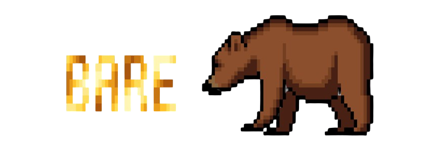

# bare

**Minimal by design. Aggressively optimized.**

*A local-first AI coding harness built to challenge the limits of efficiency.*

---

## The Vision

Bare is an experimental AI coding harness focused on lightweight architecture, intelligent context management, performance optimization, and control over AI execution.

We believe that capable AI systems should not require unnecessarily expensive infrastructure or excessive runtime overhead.

Our ambition is to challenge assumptions about what efficient software and consumer hardware can accomplish.

**Every token. Every millisecond. Every byte.**

## Architecture

### bare — The Coding Harness

A minimal, extensible terminal application for working with local and remote AI models.

Development goals:

- Lightweight terminal interface using React and Ink
- Local and remote model integrations
- Streaming responses
- Agentic coding workflows
- Shell and filesystem tools
- Conversation history and session management
- Advanced context-window management
- Selective context loading
- Prompt caching and token budgeting
- Measurable reductions in resource overhead
- Minimal dependencies and modular architecture

### bear — The Inference Engine

Bear is the planned custom local inference engine for Bare.

The engine will explore aggressive optimization techniques, potentially building on llama.cpp, with an emphasis on:

- Efficient local model execution
- Quantized inference
- Hardware-aware performance tuning
- KV-cache optimization
- Memory efficiency
- Prompt processing performance
- Token generation throughput
- Efficient CPU and GPU utilization
- Profiling, benchmarking, and experimental optimizations

Our goal is to investigate how much performance can be unlocked through careful engineering rather than simply increasing hardware requirements.

**Bear is currently a research goal, not an implemented inference engine.**

## Philosophy

### Efficiency over unnecessary complexity

Build lean systems with transparent, measurable behavior.

### Local-first intelligence

Support models that users can run and control on their own hardware.

### Performance through engineering

Challenge hardware and software limitations through experimentation, optimization, and benchmarking.

### Open development

Build publicly, document progress, and make the architecture understandable.

## Development Status

Bare is currently in early development.

### Completed

- [x] TypeScript and React foundation
- [x] Ink terminal UI
- [x] Custom pixel-art bear renderer
- [x] Animated startup sequence
- [x] Animated honey-themed logo
- [x] Initial message data types

### Planned

- [ ] Interactive chat
- [ ] Local and remote model support
- [ ] Streaming responses
- [ ] Tool execution and agent loop
- [ ] Conversation persistence
- [ ] Context and token optimization
- [ ] Performance benchmarking
- [ ] Bear inference engine

## Technology

Current: TypeScript, React, Ink, Node.js, Sharp.

Planned research: C++, llama.cpp, native inference optimization.

## Getting Started

Requirements: Node.js and npm.

Clone the repository, install dependencies, and run the development application using:

`npm install`

`npm run dev`

## Roadmap

**Phase 1:** Build the interface and conversation system.

**Phase 2:** Integrate local and remote models.

**Phase 3:** Implement an agent runtime with filesystem and shell tools.

**Phase 4:** Optimize context management, token usage, and execution overhead.

**Phase 5:** Research and prototype the Bear inference engine.

All proposed optimizations will require benchmarking and validation.

---

**bare — less overhead, more intelligence.**

*Experimental · Early Development*

